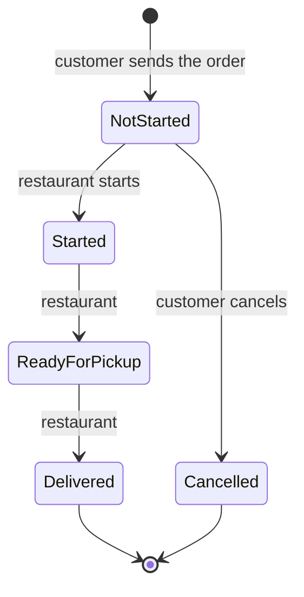

# How the order lifecycle works

This answers: *how does the lifecycle work, what happens when a customer retries after a timeout or cancels just as the restaurant starts the order,
and what is guaranteed?* The order lives in the **order service**, a separate process from the order builder. Every claim below is backed by a named
test or by output from the running service.

## The short version

An order is **Not Started**, then the restaurant moves it to **Started**, then **Ready for Pickup**, then **Delivered**. While it is Not Started the
customer can **cancel** it. (Changing a placed order is not built; see [FUTURE-WORK.md](FUTURE-WORK.md). Today a customer who wants a change cancels and places a new order.) A cancelled order shows **Cancelled**; that is a fifth, final status beyond the four in the brief, because an order has to say what happened to it.



Four ideas make it safe on unreliable mobile connections:

1. **One rule table, one door.** The legal moves are one table in `OrderLifecycle`. The only way to change an order's status is `OrderStore.Transition`, which checks the rule and applies the change as a single step under a lock.
2. **Retries are recognised.** Sending an order carries an `Idempotency-Key`; the same key means the same order. Cancelling and the restaurant's moves are safe to repeat, because asking for a status the order already has changes nothing.
3. **Whoever is refused is told the truth.** A refusal is HTTP 409 and carries the order *as it now is*, and the page shows that, not a guess.
4. **Customers and the restaurant use different doors.** `/api/orders` is the customer's; `/api/restaurant/orders` is the restaurant's. The caller's role comes from the door, never from anything the request claims.

**Who may do what.** The customer may cancel, only while Not Started (this rule is confirmed). The restaurant moves an order one step forward and cannot cancel. There is no authentication in this
project, so anyone who can reach the restaurant routes can use them; keep the service off the public internet.

## Scenario 1: the customer retries after a timeout

1. The page makes **one key per order** (a random UUID) and sends the order with it, waiting up to 10 seconds.
2. The service receives the order, prices it, saves it and remembers *key → order*. The reply is lost on the way back.
3. After 10 seconds the page gives up. It does **not** say "failed", because it cannot know. It says the order "may or may not have been received" and tells the customer that pressing the button again is safe.
4. The customer presses it. The page sends the **same key** and the same order. The service finds the key, sees it is the same request, and returns the **original order** with `Idempotency-Replayed: true`. Nothing new is created.
5. If the customer *changed* the order or their name first, that is a different request, so the page makes a **new key**. The same key arriving with a different order is refused (422) rather than answered with the wrong order.
6. A clear refusal (HTTP 4xx) means nothing was created, so the next attempt starts fresh. A server error (5xx) is treated like a timeout: the order might exist, so the key is kept.

If the restaurant has already started the order by the time the retry arrives, the retry returns the order with its *current* status.

## Scenario 2: the customer cancels at the moment the restaurant starts

Both requests reach the service at nearly the same instant. The store decides them **one after the other**, in whichever order they enter its critical section. There are exactly two outcomes, both correct:

| Who got in first | Cancel result | Restaurant result | Final status |
|---|---|---|---|
| The customer | 200, Cancelled | 409: the order is Cancelled and can no longer change | Cancelled |
| The restaurant | 409: "The restaurant has already started this order, so it can no longer be cancelled." | 200, Started | Started |

There is no third outcome: both cannot succeed, and neither is silently ignored. The refused side receives the order as it now stands, so the customer's screen switches to "Started" and shows the reason. A repeated cancel is safe: asking for the status the order already has returns 200 and records nothing new.

**Output from the running service** (`scripts/demo-order-service.sh` against a separate order-service process):

```
=== 1. Retry after a timeout ===============================================
The customer sends the order with Idempotency-Key: demo-1793210102-10556
  attempt 1 -> HTTP 201, order d5b33f203f2e4e1a812e1c13ebb3cb6a, status NotStarted
  ...the reply is lost on the way back. The phone times out and sends the SAME request again:
  attempt 2 -> HTTP 200, order d5b33f203f2e4e1a812e1c13ebb3cb6a, Idempotency-Replayed: true
  orders held for "Demo 23283": 1   (one, not two)
  Reusing that key for a DIFFERENT order is refused:
  HTTP 422: This Idempotency-Key was already used for a different order request.

=== 2. Cancel at the moment the restaurant starts ============================
  round 1: customer cancel -> HTTP 200 | restaurant start -> HTTP 409 | final status Cancelled | history: Placed -> Cancelled
  round 2: customer cancel -> HTTP 409 | restaurant start -> HTTP 200 | final status Started | history: Placed -> Started
  round 3: customer cancel -> HTTP 200 | restaurant start -> HTTP 409 | final status Cancelled | history: Placed -> Cancelled
  round 4: customer cancel -> HTTP 200 | restaurant start -> HTTP 409 | final status Cancelled | history: Placed -> Cancelled
  round 5: customer cancel -> HTTP 409 | restaurant start -> HTTP 200 | final status Started | history: Placed -> Started
  Exactly one wins each round; the other gets 409 and the true status.
Once the restaurant has started, the customer can no longer cancel:
  HTTP 409: The restaurant has already started this order, so it can no longer be cancelled.
```

## What is guaranteed, and how

| # | Guarantee | How it is provided | Proved by |
|---|---|---|---|
| G1 | One order per idempotency key, even for simultaneous duplicates | Key checked and order saved inside one lock | ORD-004: `Many_simultaneous_duplicate_submissions…`, `A_retry_that_arrives_while_the_first_attempt_is_still_being_saved…` |
| G2 | A key never returns a different order | The request is fingerprinted; a mismatch is 422 | ORD-004 |
| G3 | Only legal moves; a refused move changes nothing | One rule table, checked in `Transition` | LIFE-001: every from/to pair against a hand-written table |
| G4 | A customer's cancel and the restaurant's start cannot both win | One lock around check-and-apply | LIFE-003: tests freeze one request mid-change and check the other must wait |
| G5 | The customer can cancel only while Not Started | Actor rule plus status rule; the service sends `canCustomerCancel` | LIFE-004 |
| G6 | A refused caller is told the true, current status | A 409 carries the current order; the page applies it | LIFE-003, UI-016 |
| G7 | Repeating a cancel or a restaurant move is harmless | Asking for the current status succeeds and records nothing | LIFE-005 |
| G8 | The history is a faithful, ordered record | Appended only on a real change | LIFE-002 |
| G9 | The price is the service's, and never changes after the order is placed | The shared pricing library runs in the service; orders are immutable snapshots | ORD-002, ORD-003 |
| G10 | The screen never moves an order backwards or invents a status | A snapshot with a shorter history is ignored; a failed refresh keeps the last known status and says so | UI-017 |

Removing the lock from `Transition` or `Create` makes the corresponding race tests fail (checked by doing it). Timing-based race tests were *not* enough: on a one-core machine they kept passing with the lock removed.

## What is not guaranteed

- **Durability.** Orders and keys are in memory. A restart loses both, so a retry that spans a restart could create a duplicate.
- **More than one service instance.** The lock is in-process; a shared database with a unique key would be needed (ADR-0010).
- **Protection of the restaurant routes.** No authentication, by the project's scope.
- **Instant screens.** Status is polled every 5 seconds, so a screen can be up to 5 seconds behind. Every action is re-checked by the service, so a stale screen is never wrong in a way that matters.
- **Key expiry.** Keys live as long as the process.
- **Changing a placed order.** Not built, on purpose; see [FUTURE-WORK.md](FUTURE-WORK.md).

## See it yourself

```bash
scripts/dev.sh                          # builder page, builder API and order service
scripts/demo-order-service.sh           # the scenarios above, against the running service
scripts/restaurant.sh start <orderId>   # play the restaurant by hand
```

Reasoning and rejected alternatives: [ADR-0007](decisions/ADR-0007-order-lifecycle-and-concurrency.md), [ADR-0008](decisions/ADR-0008-idempotent-order-submission.md),
[ADR-0009](decisions/ADR-0009-separate-order-service.md). Rules the tests protect: [INVARIANTS.md](INVARIANTS.md) (LIFE-001 to 006, ORD-002 to 004, UI-015 to 017). Deferred: [FUTURE-WORK.md](FUTURE-WORK.md).
